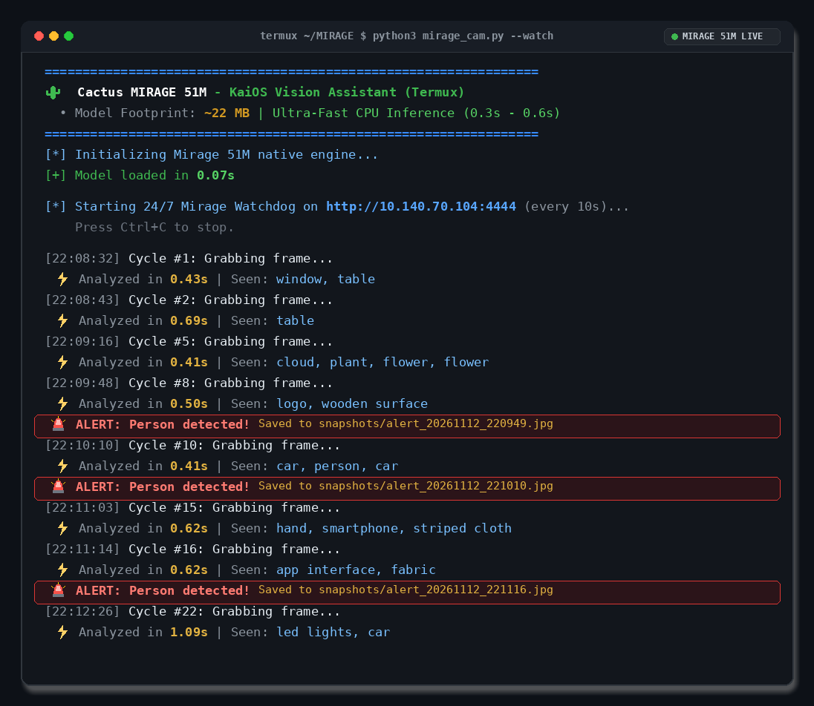

# 🤖 AI Watchdog (Powered by Mirage 51M)

Turn your KaiOS phone into a **100% on-device AI Smart Security Camera**.

Using the ultra-compact **Mirage 51M** Vision-Language Model (VLM), the AI Watchdog continuously monitors your camera feed, understands scenes in natural language, and sends real-time photo alerts to your **Telegram** or **Discord**!

<p align="center">
  
</p>

## ✨ Key Features
* 🧠 **100% On-Device AI**: Powered by Cactus Mirage (51M parameters, ~22 MB model footprint).
* ⚡ **Fast CPU Inference**: Runs in ~1 second on standard CPUs without requiring an expensive GPU or cloud API.
* 🔒 **Zero Cloud & Zero Subscriptions**: 100% private. No video or data ever leaves your local network.
* 📱 **Instant Mobile Alerts**: Sends detected event photos directly to your Telegram chat or Discord channel.
* 📦 **Plug & Play**: Works on Android (Termux), Linux, macOS, and Windows.

---

## 🚀 Quickstart

### 1. Requirements
```bash
# On Termux:
pkg install python-pillow

# On PC / Linux / macOS:
pip install pillow
```

### 2. Start the AI Watchdog
```bash
python3 ai_watchdog.py --ip 192.168.1.15
```
*(Replace `192.168.1.15` with your KaiOS phone's Wi-Fi IP address).*

---

## 🔔 Enabling Instant Phone Alerts

### Discord Webhook Alerts:
```bash
python3 ai_watchdog.py --ip 192.168.1.15 --discord "https://discord.com/api/webhooks/..."
```

### Telegram Bot Alerts:
```bash
python3 ai_watchdog.py --ip 192.168.1.15 --telegram-token "YOUR_BOT_TOKEN" --telegram-chat-id "YOUR_CHAT_ID"
```

---

## ⚙️ Options & Arguments

| Flag | Default | Description |
| :--- | :--- | :--- |
| `--ip` | *(prompt)* | IP address of your KaiOS camera |
| `--port` | `4444` | Camera streaming port |
| `--interval` | `8` | Seconds between AI vision checks |
| `--ask` | `""` | Custom question (e.g. `"Is there a dog on the couch?"`) |
| `--discord` | `""` | Discord Webhook URL for alerts |
| `--telegram-token` | `""` | Telegram Bot API token |
| `--telegram-chat-id` | `""` | Telegram chat ID for alert delivery |
| `--save-dir` | `alerts/` | Folder where alert snapshots are stored |

---
Part of the [KaiOS IP Camera](https://github.com/su60pi/kaios-ip-camera) project by [su60pi](https://github.com/su60pi).
